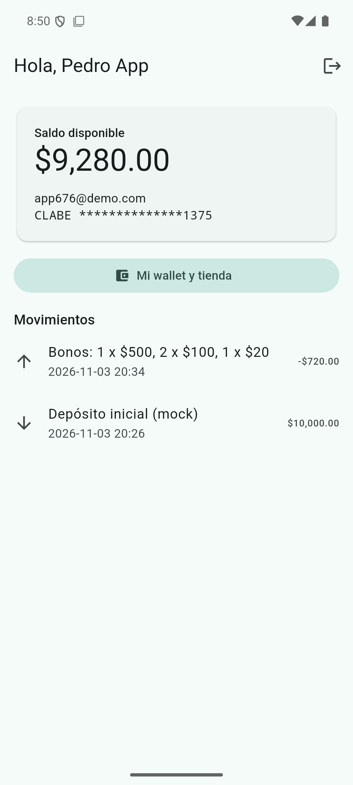
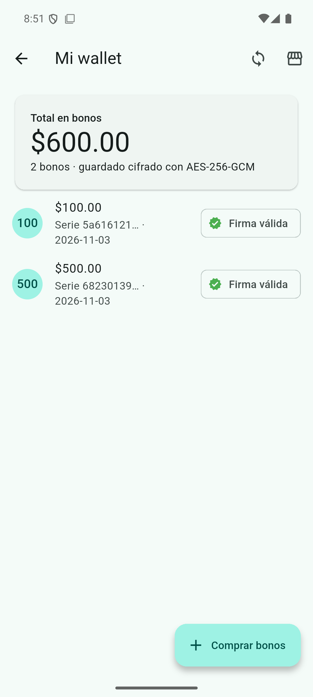
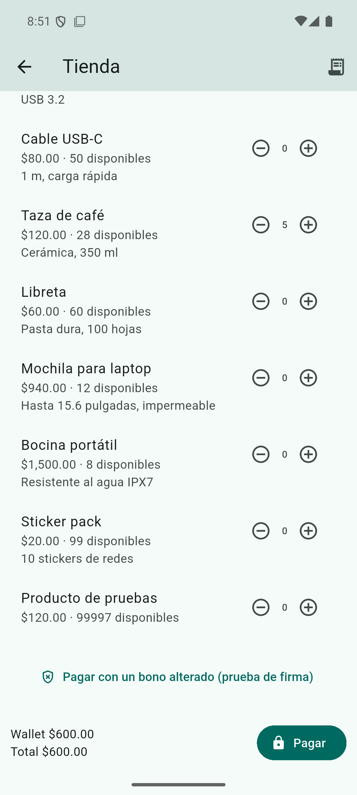
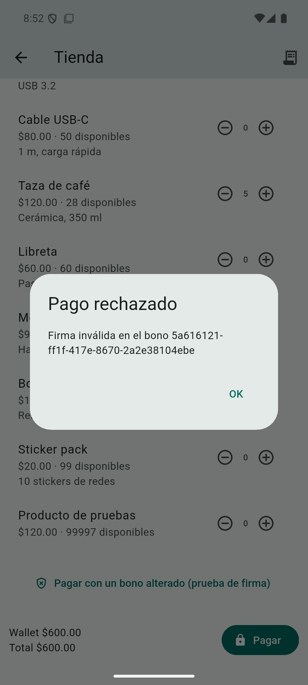
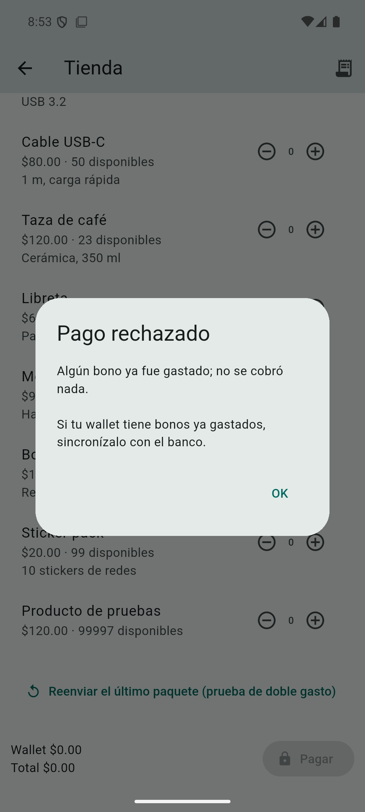

# ProyectoIntercomunicaciones — App (Flutter)

App Android del monedero digital de bonos. El usuario compra bonos firmados por el **Banco** ($500, $300, $100,
$50, $20), los guarda cifrados en el celular y paga con ellos en la **Tienda online**.
Backend (Banco.Api + Tienda.Api): [ProyectoIntercomunicaciones_Backend](https://github.com/YaxOFF/ProyectoIntercomunicaciones_Backend).

Guion para presentar en clase: [docs/GUION-DEMO.md](docs/GUION-DEMO.md).

| Inicio | Wallet | Tienda | Bono alterado | Doble gasto |
|---|---|---|---|---|
|  |  |  |  |  |

## Correr

Requisitos: Flutter 3.44+, Android SDK con un emulador (AVD), y el backend levantado (ver su README:
`docker compose up -d --build`).

```bash
flutter pub get
flutter run                      # con el emulador abierto
flutter analyze                  # sin issues
flutter test                     # firma RSA-PSS, wallet con PIN, elección de bonos
```

El emulador llega a la máquina por `10.0.2.2`: banco `http://10.0.2.2:5001`, tienda `http://10.0.2.2:5002`
(`lib/config.dart`). Para otro host: `flutter run --dart-define=BANCO_URL=http://... --dart-define=TIENDA_URL=http://...`.
Es HTTP en local (`usesCleartextTraffic`); en producción sería HTTPS.

Usuarios demo: `ana@demo.com` / `luis@demo.com`, contraseña `demo123` ($10,000 cada uno). El PIN del wallet lo
eliges la primera vez que lo abres (4-8 dígitos).

## Qué hace cada pantalla

- **Login / Registro**: JWT del banco guardado en `flutter_secure_storage`. Las cuentas nuevas nacen con $10,000.
- **Inicio**: saldo, CLABE enmascarada (el banco la guarda cifrada con AES-GCM), movimientos.
- **Wallet** (pide PIN): bonos con chip **Firma válida**, verificada en la app con la llave pública del banco.
  Botón sincronizar trae los bonos `EMITIDO` del banco.
- **Comprar bonos**: contador por denominación, descuenta saldo en el banco.
- **Tienda**: catálogo y carrito. Al pagar elige los bonos que cubren el total con el menor excedente.
  Cifra el pedido y lo envía. El cambio llega como bonos nuevos firmados por el banco y entra al wallet. Botones de demo: *Pagar con un bono alterado* y *Reenviar el último paquete*.
- **Mis pedidos**: historial del comprador.

## Seguridad en la app

| Qué | Cómo | Archivo |
|---|---|---|
| Verificar bonos | RSA-PSS + SHA-256 (salt 32) sobre `serie\|denominacion\|emitidoEn`, llave pública del banco (PEM) | `lib/cripto.dart` → `verificarBono` |
| Wallet en el celular | AES-256-GCM con llave derivada del PIN (PBKDF2-HMAC-SHA256, 100k iteraciones, salt 16). PIN incorrecto = falla el tag GCM | `lib/cripto.dart` → `LlaveWallet`, `lib/wallet.dart` |
| Pago a la tienda | Híbrido: JSON cifrado con AES-256-GCM (llave y nonce de un solo uso) + llave AES cifrada con RSA-OAEP-SHA256 de la tienda | `lib/cripto.dart` → `cifrarPaquete` |

Librerías: `pointycastle` (RSA, AES-GCM, PBKDF2) y `basic_utils` (leer PEM). El análisis completo de amenazas
está en `SEGURIDAD.md` del backend.

## Estructura

```
lib/config.dart       URLs del banco y la tienda
lib/api.dart          cliente HTTP (JWT, errores {error} → ApiError)
lib/cripto.dart       firma, wallet cifrado, paquete híbrido, elegirBonos
lib/wallet.dart       wallet por usuario en secure storage
lib/pantallas/        login, registro, inicio, wallet, comprar_bonos, tienda (+ pedidos)
test/                 pruebas con un bono y una llave reales del banco
docs/                 capturas y guion de demo
```
